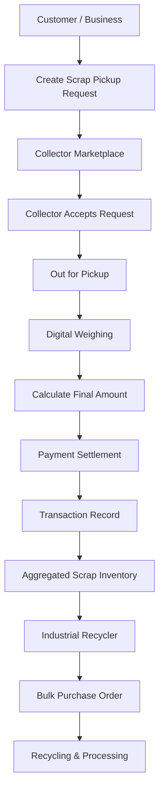

# ♻️ RecyConnect
### Connecting Collectors. Empowering Recycling. Building a Greener Future.

**RecyConnect** is an enterprise-oriented, full-stack Django web application that digitizes and streamlines the informal scrap collection and recycling ecosystem. It connects households and commercial businesses with verified scrap collectors, while enabling industrial recycling companies to procure recyclable materials through a transparent, technology-driven marketplace.

The platform simplifies doorstep scrap collection, introduces transparent digital weighing and pricing, automates transaction records, and promotes a circular economy by connecting local waste collection networks directly with industrial recyclers.

---

## 🌍 The Problem We're Solving

The informal scrap collection industry plays a crucial role in waste management, but it often operates through fragmented and unorganized processes.

Some of the major challenges include:

- **Lack of Transparency:** Unstandardized scrap pricing and manual weight measurements.
- **Limited Accessibility:** Difficulty finding reliable scrap collectors for doorstep pickups.
- **Fragmented Supply Chains:** No direct digital connection between local collectors and industrial recyclers.
- **Poor Traceability:** Limited digital records of collected, processed, and transferred recyclable materials.
- **Inefficient Operations:** Manual scheduling, tracking, payments, and inventory management.

### 💡 Our Solution

RecyConnect brings these stakeholders together through a unified digital ecosystem, making scrap collection more accessible, transparent, accountable, and efficient.

---

## ✨ Key Features

### 1. 👤 Multi-Role Authentication & Access Control

A role-based ecosystem designed for four different stakeholders:

- **Customers:** Household and commercial users.
- **Scrap Collectors:** Verified individuals managing collection requests.
- **Industrial Recyclers:** Companies purchasing recyclable materials in bulk.
- **Platform Administrators:** Managing users, pricing, verification, and platform analytics.

Features include custom Django User authentication, role-based authorization, protected dashboards, and profile management.

### 2. 🏠 Customer Portal

- Instant scrap value estimation using indicative market prices.
- Schedule doorstep scrap collection.
- Select preferred pickup dates and time slots.
- Specify estimated scrap weight and categories.
- Upload scrap images for better collection assessment.
- Track pickup progress through a real-time status timeline.
- Cancel pickup requests before dispatch.
- Access digital weighing receipts and environmental impact information.

**Pickup Lifecycle:**

`Pending → Assigned → Out for Pickup → Completed & Paid`

### 3. 🚛 Scrap Collector Portal

- Collector registration and profile verification.
- Vehicle and service-area management.
- Open pickup marketplace to discover unassigned collection requests.
- Accept available pickup requests with one click.
- Update collection and transit statuses.
- Record verified scrap weight and agreed price per kilogram.
- Automatically calculate transaction amounts.
- Generate digital transaction records.
- Support cash and instant UPI settlement tracking.

**Transaction Calculation:**

`Total Amount = Actual Weight (kg) × Agreed Rate (₹/kg)`

### 4. 🏭 Industrial Recycler Marketplace

A dedicated procurement portal connecting industrial recycling companies with local scrap collection networks.

- Browse aggregated recyclable inventory.
- Monitor available scrap quantities by category.
- Place bulk purchase requests.
- Define custom procurement rates.
- Specify acceptable moisture thresholds.
- Configure facility unloading addresses.
- Maintain purchase and procurement records.
- Support EPR traceability documentation workflows.

### 5. 📊 Administrator Dashboard

A centralized platform management and monitoring system.

**Executive Analytics:**
- Total recycled volume (kg).
- Total transaction turnover.
- Active platform users.
- Registered and verified collectors.
- Monthly recycling and turnover trends.
- Scrap category distribution.

**Administrative Operations:**
- Collector identity verification queue.
- User and role management.
- Pickup monitoring.
- Complaint and dispute investigation.
- Scrap category management.
- Indicative market price management.

**Visualizations:** Interactive Chart.js doughnut and trend charts.

---

## 🛠️ Technology Stack

| Layer | Technologies |
|---|---|
| Backend | Python 3, Django 6 |
| Frontend | HTML5, CSS3, JavaScript ES6 |
| UI Framework | Bootstrap 5.3 |
| Icons | Bootstrap Icons |
| Database | SQLite / PostgreSQL |
| Authentication | Django Authentication, Custom User Model |
| Data Visualization | Chart.js 4.4 |
| Image Processing | Pillow |
| Architecture | Django MVT (Model-View-Template) |

---

## 🏗️ Project Architecture

The application follows a modular Django architecture, separating business responsibilities into dedicated applications.

```text
recyconnect/
│
├── manage.py
├── requirements.txt
├── .env.example
├── README.md
│
├── config/
│   ├── settings.py
│   ├── urls.py
│   ├── wsgi.py
│   └── asgi.py
│
├── accounts/
│   ├── models.py
│   ├── forms.py
│   ├── views.py
│   ├── urls.py
│   ├── admin.py
│   └── decorators.py
│
├── scrap/
│   ├── models.py
│   ├── forms.py
│   ├── views.py
│   ├── urls.py
│   └── admin.py
│
├── pickups/
│   ├── models.py
│   ├── forms.py
│   ├── views.py
│   ├── urls.py
│   └── admin.py
│
├── transactions/
│   ├── models.py
│   ├── views.py
│   ├── urls.py
│   └── admin.py
│
├── recyclers/
│   ├── models.py
│   ├── forms.py
│   ├── views.py
│   ├── urls.py
│   └── admin.py
│
├── dashboard/
│   ├── views.py
│   └── urls.py
│
├── core/
│   ├── models.py
│   ├── forms.py
│   ├── views.py
│   ├── urls.py
│   ├── context_processors.py
│   ├── tests.py
│   └── management/
│       └── commands/
│           └── seed_data.py
│
├── static/
│   ├── css/
│   │   └── styles.css
│   └── js/
│       └── main.js
│
├── templates/
│   ├── base.html
│   ├── core/
│   ├── accounts/
│   ├── scrap/
│   ├── pickups/
│   ├── transactions/
│   ├── recyclers/
│   └── dashboard/
│
└── media/
```

### Application Responsibilities

| Django App | Responsibility |
|---|---|
| `accounts` | Authentication, profiles, roles and permissions |
| `scrap` | Scrap categories, indicative pricing and price management |
| `pickups` | Scheduling, assignments and pickup lifecycle |
| `transactions` | Digital weighing, settlement and transaction records |
| `recyclers` | Bulk procurement and recycler marketplace |
| `dashboard` | Role-specific dashboards and analytics |
| `core` | Homepage, static pages, complaints and contact management |

---

## 🔄 How RecyConnect Works



---

## 🚀 Getting Started

Follow these instructions to set up RecyConnect locally.

### Prerequisites

Make sure you have installed:

- Python 3
- pip
- Git
- A code editor (VS Code recommended)

### 1. Clone the Repository

```bash
git clone <repository_url>
cd RecyConnect
```

### 2. Create a Virtual Environment

```bash
python -m venv venv
```

**Windows:**

```bash
venv\Scripts\activate
```

**Linux / macOS:**

```bash
source venv/bin/activate
```

### 3. Install Dependencies

```bash
pip install -r requirements.txt
```

### 4. Configure Environment Variables

Create your local `.env` file using `.env.example` as a reference.

Configure your Django secret key, database credentials, and other environment-specific settings as required.

Never commit your actual `.env` file or production secrets.

### 5. Apply Database Migrations

```bash
python manage.py makemigrations
python manage.py migrate
```

### 6. Populate Demonstration Data

```bash
python manage.py seed_data
```

The seed command populates the application with demonstration users, scrap categories, pickup requests, and purchase orders.

### 7. Start the Development Server

```bash
python manage.py runserver
```

Open your browser:

**http://127.0.0.1:8000/**

---

## 🔑 Demo Credentials

The seed script creates demonstration accounts for all major platform roles.

| Role | Username | Password |
|---|---|---|
| Administrator | `admin` | `admin123` |
| Household Customer | `customer1` | `pass123` |
| Commercial Customer | `business1` | `pass123` |
| Verified Collector | `collector1` | `pass123` |
| Pending Collector | `collector2` | `pass123` |
| Industrial Recycler | `recycler1` | `pass123` |

**Note:** These credentials are strictly for local demonstration purposes. Change or remove them before deploying the application to production.

---

## 🧪 Testing

Run the automated test suite:

```bash
python manage.py test
```

The test suite is designed to validate:

- Business logic and transaction calculations.
- Role-based access permissions.
- Pickup scheduling and status transitions.
- Ownership and authorization restrictions.
- Application endpoints and workflow integration.

**Expected result (as configured in the current project):**

```text
Ran 6 tests
OK
```

---

## 🔐 Security & Data Integrity

RecyConnect incorporates multiple application-level security and validation mechanisms.

| Security Area | Implementation |
|---|---|
| Authentication | Django built-in authentication with custom User model |
| Authorization | Role-based access control decorators |
| CSRF Protection | Django CSRF middleware and form tokens |
| Transaction Integrity | Server-side weight and price calculations |
| Ownership Validation | Users can access only their authorized records |
| Collector Verification | Admin-controlled collector verification |
| Auditability | Transaction records linked to completed pickups |
| Input Validation | Django forms and model-level validation |

### Important Business Rules

1. Customers can only view and cancel their own eligible pickup requests.
2. Collectors can only complete pickups assigned to them.
3. Transaction amounts are calculated on the server using verified weight and agreed rates.
4. Completed pickups generate linked transaction records.
5. Collector access to protected marketplace operations depends on verification status.

---

## 🌱 Environmental Impact

RecyConnect aims to make recycling measurable and accessible.

The platform supports a more organized recycling ecosystem by:

- Encouraging responsible household and commercial waste disposal.
- Connecting local collectors with larger recycling facilities.
- Improving visibility into collected recyclable materials.
- Promoting digital records of recycled volumes.
- Supporting traceability across the recycling supply chain.
- Encouraging the circular economy through better material recovery.

**Our vision:** Turn every recyclable item into an opportunity for a cleaner, more sustainable future.

---

## 🔮 Future Enhancements

Potential improvements to expand the platform:

- [ ] Live GPS-based collector tracking.
- [ ] Google Maps integration for optimized pickup routes.
- [ ] Real-time notifications using Django Channels and WebSockets.
- [ ] Automated UPI payment gateway integration.
- [ ] Dynamic scrap pricing based on market indices.
- [ ] AI-powered scrap category identification using uploaded images.
- [ ] Advanced EPR compliance and traceability reporting.
- [ ] PostgreSQL production deployment.
- [ ] Docker containerization and CI/CD automation.
- [ ] Advanced environmental impact analytics.
- [ ] Collector ratings and customer feedback.

---

## 👨‍💻 Authors

Developed collaboratively by:

- **Ankush**
- **Priyanshu**
- **Pintu**

---

## 🤝 Contributing

Contributions, suggestions, and feature improvements are welcome.

1. Fork the repository.
2. Create a feature branch:

   ```bash
   git checkout -b feature/your-feature-name
   ```

3. Commit your changes:

   ```bash
   git commit -m "feat: add your feature"
   ```

4. Push your branch:

   ```bash
   git push origin feature/your-feature-name
   ```

5. Open a Pull Request.

---

## 📜 License

This project is currently developed for educational and demonstration purposes. Add an appropriate open-source license before permitting external redistribution.

---

<p align="center">
  <b>♻️ RecyConnect — Connecting Collectors. Empowering Recycling.</b>
  <br/>
  Building a greener future, one collection at a time.
</p>
